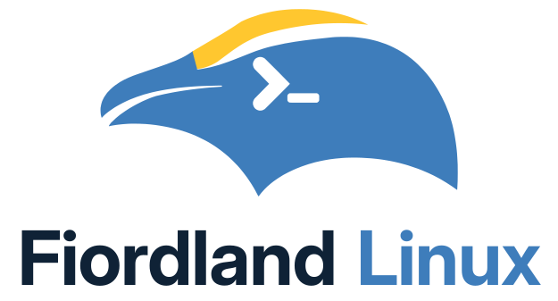

<p align="center">
  <picture>
    <source media="(prefers-color-scheme: dark)" srcset=".github/banner-dark.svg">
    
  </picture>
</p>

<p align="center">Arch-based, fast and stable, with its own installer, package manager and shell.<br>
Named after the Fiordland penguin, the tawaki.</p>

<p align="center"><a href="https://fiordlandlinux.org">fiordlandlinux.org</a></p>

<p align="center">Created by <a href="https://apollo44.lat">Apollo</a> (<a href="https://github.com/3cfl">3cfl</a> on GitHub, u5sk on Discord)</p>

<p align="center"><a href="https://donate.stripe.com/8x25kFfe96fn0WL6X12wU00"></a> <a href="https://discord.gg/gy4ANH2Q9V"></a></p>

<p align="center"></p>

<p align="center">


</p>

<p align="center"></p>

<p align="center"><sub>Hyprland with crest · KDE Plasma · niri · the rawaru installer</sub></p>

## What's inside

| Path | What it is |
|------|------------|
| `crest/` | Fiordland's own Hyprland shell, one of the options in the installer. Bar, launcher, notifications, quick settings, lock screen, overview, settings. Plain QML on Quickshell with Material 3 Expressive shapes and glass over Hyprland's blur, no C++ plugin. `crest-greeter/` is its greetd login screen. |
| [tawaki](https://github.com/Fiordland-Linux/tawaki) | Package manager in Rust, in its own repo. One command that picks the cleanest source: pacman, then Flathub, then AUR. |
| [rawaru](https://github.com/Fiordland-Linux/rawaru) | Graphical installer, in its own repo (PySide6 + QML). Pick from 11 desktops and 13 window managers, with optional dotfiles (crest, Noctalia, Dux, Caelestia, end-4, HyDE, ML4W, JaKooLit, iNiR). Btrfs with snapper snapshots, zram, GRUB, GPU driver detection, CachyOS, Fiordland or Arch kernel, and a Low-end PC switch. |
| `packages/` | PKGBUILDs for everything above (tawaki and rawaru build from their tagged GitHub releases), plus `fiordland-desktop` (theme, icons, configs, defaults). |
| `iso/` | archiso profile for the live ISO. |
| `web/` | The website. |
| `tools/` | Build helpers: chroot builds, colour scheme and wallpaper generators, VM control, lint and release checks. |
| `docs/` | Guides: [installing](docs/install.md), [tawaki](docs/tawaki.md), [undoing an update](docs/rollback.md), the [linux-fiord kernel](docs/kernel.md), and the [signing key](docs/signing-key.md) for maintainers. |

## tawaki

```
tawaki install spotify      i
tawaki remove spotify       r, rm
tawaki update               u, up
tawaki search obs           s
tawaki list                 ls
tawaki install foo --from aur
```

If the top pick is a Flatpak that would pull a big runtime you don't have yet, tawaki takes a prebuilt pacman or AUR package instead, and tells you how much it skipped. The Flathub catalogue refreshes in the background, so searches never wait on it.

Config: `~/.config/tawaki/config.toml`

```toml
priority = ["pacman", "flatpak", "aur"]
aur_helper = "auto"
flatpak_scope = "user"
flatpak_remote = "flathub"
prefer_light = true
```

## Kernel and drivers

Installs default to the [CachyOS](https://cachyos.org) kernel (`linux-cachyos`), pulled from CachyOS's baseline `[cachyos]` repo, which sits after the Arch repos so only CachyOS-only packages come from it. The stock Arch `linux` kernel stays installed as a second boot entry. Pick "Arch kernel" in the installer to skip the CachyOS kernel, or "Fiordland" for [linux-fiord](docs/kernel.md), our own kernel built for the x86-64 baseline.

The installer detects the GPU: NVIDIA Turing and newer get `nvidia-open` (plus `linux-cachyos-nvidia-open`), older NVIDIA cards use nouveau, Intel and AMD get the matching Vulkan and VA-API drivers. Multilib is enabled for Steam and Wine.

## Gaming

Every install comes with the `fiordland-gaming` meta package: Steam, proton-cachyos, wine-cachyos, umu-launcher, protontricks, winetricks, gamemode, MangoHud and gamescope. Existing installs get it in the background after updating to fiordland-base 0.9.1. Remove it with `sudo pacman -Rns fiordland-gaming`.

## Development

`fiordland-dev` is an opt-in meta package for programming: base-devel, git, git-lfs, github-cli, cmake, meson, ninja, clang, lldb, gdb, valgrind, strace, Python with pip and pipx, Node.js and npm, rustup, Go, OpenJDK, podman and podman-compose, shellcheck, jq, ripgrep, fd and man pages. Install it with `tawaki install fiordland-dev`, then run `rustup default stable` for Rust.

## crest

Runs with `qs -c crest`. Settings live in `~/.config/crest/config.json` and in the settings window (Super + I). Colours come from the wallpaper through matugen, with the Fiordland palette as the fallback. Low-end mode turns off blur, shadows and most animation, and switches on by itself under software rendering or with less than 4 GB of memory. See [crest/README.md](crest/README.md) for shortcuts and IPC.

## Building

Needs an Arch-based host with `archiso`, `devtools` and `base-devel`.

```
./build.sh            build all packages and the ISO into out/
SKIP_AUR=1 ./build.sh skip the chroot builds of crest and crest-greeter
REBUILD_KERNEL=1 ./build.sh rebuild linux-fiord even if its version is published
./vm.sh --share       boot the ISO in QEMU
```

Installed systems use the package repo at `https://fiordlandlinux.org/repo/x86_64`.

## Contributing

See [CONTRIBUTING.md](CONTRIBUTING.md) for the repo layout, how to build and test, and the conventions. Run `tools/lint.sh` before opening a pull request.

## Security

Report vulnerabilities privately; see [SECURITY.md](SECURITY.md). Signing key handling and backups: [docs/signing-key.md](docs/signing-key.md).

## Credits

Fiordland Linux was created by [Apollo](https://apollo44.lat) ([3cfl](https://github.com/3cfl), u5sk on Discord), who designs and maintains it, with help from the contributors listed on GitHub. It builds on:

- [Caelestia shell](https://github.com/caelestia-dots/shell) by the Caelestia contributors, which the earlier crest was forked from, and [end-4's dots-hyprland](https://github.com/end-4/dots-hyprland), which crest 1 draws on (both GPL-3.0)
- [Quickshell](https://quickshell.org) by outfoxxed and contributors, which crest is built on
- [CachyOS](https://github.com/CachyOS/linux-cachyos), whose kernel packaging linux-fiord is forked from
- [archiso](https://gitlab.archlinux.org/archlinux/archiso), the base of the ISO profile
- AUR maintainers of the bundled PKGBUILDs in `packages/aur/`
- Tawaki photos on the website from Wikimedia Commons, credited per photo
- Tux by Larry Ewing, Simon Budig and Garrett LeSage, made with The GIMP. Used as the temporary Fiordland mascot and logo.

## License

GPL-3.0. See [LICENSE](LICENSE).
